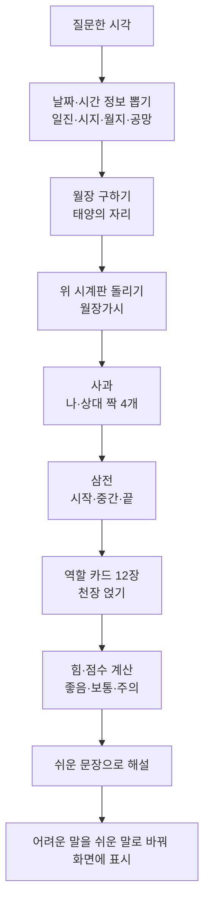

# 육임은 어떻게 계산될까요? (쉽게 풀어 쓴 설명)

> 이 문서는 **초등학교 고학년(12살)** 친구도 이해할 수 있도록,
> 앱이 "오늘의 육임"을 만들어 내는 순서를 쉬운 말로 설명합니다.
> 어려운 한자 용어는 괄호 안에 살짝만 적어 둘게요.

---

## 1. 육임이 뭐예요?

**육임(六壬)**은 아주 오래된 동양의 점(占)입니다.
"지금 이 순간의 하늘과 시간이 어떤 모양인지"를 보고,
내가 궁금한 일이 **어떻게 시작해서 → 어떻게 흘러 → 어떻게 끝날지**를 이야기로 풀어 줍니다.

주사위를 굴리는 게 아니라, **질문한 바로 그 시각**을 재료로 계산합니다.
그래서 **같은 시각에 같은 질문**을 하면 **항상 똑같은 결과**가 나와요.
(우리 앱도 난수(랜덤)를 전혀 쓰지 않습니다.)

---

## 2. 준비물은 딱 하나, "시각"

필요한 건 **질문한 순간의 시각** 하나입니다.
그 시각에서 다음 네 가지를 뽑아냅니다. 이건 만세력(달력) 규칙으로 정해져요.

| 뽑아내는 것 | 쉬운 설명 |
|---|---|
| 일진(日辰) | 오늘이 어떤 날인지 나타내는 이름표 (예: 갑자일) |
| 시지(時支) | 지금이 12개 시간 중 몇 번째 시간인지 |
| 월지(月支) | 지금이 어느 계절 기운인지 |
| 공망(空亡) | 오늘 "잠깐 비어 있는" 두 칸이 무엇인지 |

> **십이지(十二支)** 란 쥐·소·호랑이·토끼… 처럼 **12개의 이름표**예요.
> 육임은 이 12칸을 시계처럼 빙 둘러놓고 계산합니다.

---

## 3. 시계판 두 개를 준비해요

육임의 핵심은 **시계판 두 개**를 상상하는 거예요.

- **바닥 시계판(지반, 地盤)**: 벽에 붙어서 **절대 안 움직이는** 시계판. 12칸이 항상 같은 자리에 있어요.
- **위 시계판(천반, 天盤)**: 그 위에 겹쳐 놓은 **투명하고 돌아가는** 시계판.

```
      위 시계판(천반) ← 빙글빙글 돌아감
   ┌─────────────────────┐
   │  바닥 시계판(지반)   │ ← 고정
   └─────────────────────┘
```

이제 위 시계판을 **얼마나 돌릴지**만 정하면 됩니다.

---

## 4. 위 시계판을 돌리는 법 — "태양을 지금 시간 위에 올리기"

돌리는 규칙의 이름은 **월장가시(月將加時)** 예요.
말이 어렵지, 뜻은 아주 간단합니다.

> **"지금 태양이 있는 자리(월장)를, 지금 시간 칸 위에 딱 맞춰 올려놓아라."**

- **월장(月將)** = 지금 하늘에서 **태양이 어느 칸에 있는지**.
  계절이 바뀌면 한 칸씩 옮겨 가요. 우리 앱은 태양의 위치를 직접 계산해서 정확하게 맞춥니다.
- 그 태양 칸을 **지금 시간 칸** 위에 올리면, 위 시계판이 저절로 얼마나 돌지 정해집니다.
- 한 칸만 맞추면 나머지 11칸도 **자동으로** 따라 정해져요.

이 "돌린 양"이 틀리면 뒤의 계산이 전부 어긋나기 때문에, 여기가 **제일 중요한 단계**예요.

---

## 5. 사과(四課) — 나와 상대의 짝 4개 만들기

이제 시계판이 완성됐으니, 여기서 **네 개의 짝**을 뽑습니다. 이걸 **사과(四課)** 라고 해요.

- **1과, 2과** = **"나"** 와 나를 둘러싼 상황
- **3과, 4과** = **"상대(또는 그 일)"** 와 그 주변 상황

각 짝은 "바닥 칸 위에 어떤 위 칸이 올라와 있나"를 보는 거예요.
쉽게 말하면 **"나는 지금 무엇을 머리에 이고 있나?"**, **"상대는 무엇을 이고 있나?"** 를 보는 겁니다.

---

## 6. 삼전(三傳) — 이야기의 시작·중간·끝

사과에서 뽑아낸 세 칸을 순서대로 늘어놓은 것이 **삼전(三傳)** 입니다.
이게 육임 이야기의 **뼈대**예요.

| 이름 | 우리 앱 표시 | 뜻 |
|---|---|---|
| 초전(初傳) | 🌱 시작 | 일이 **어떻게 시작하는지** |
| 중전(中傳) | 🔄 중간 | 가운데서 **어떤 고비를 지나는지** |
| 말전(末傳) | 🏁 마무리 | 결국 **어디로 끝나는지** |

**시작 칸을 어떻게 고르는지**에는 9가지 규칙이 있어요(구종법, 九宗法).
"누가 누구를 이기나(극, 剋)"를 순서대로 따져서 딱 하나를 고릅니다.
예를 들면 이런 순서로 확인해요.

1. 두 시계판이 완전히 겹쳤나? (복음)
2. 정반대로 뒤집혔나? (반음)
3. 서로 이기는 칸이 하나뿐인가? (적극)
4. 이기는 칸이 여러 개면, 나와 성질(음·양)이 같은 걸 고른다 (비용)
5. 그래도 못 정하면, **더 험한 길을 뚫고 온 칸**을 고른다 (섭해)
6. … 그래도 없으면 다른 특별 규칙들로 정한다

시작 칸이 정해지면, 중간·끝 칸은 **위 시계판을 따라 한 칸씩 이어**서 자동으로 정해져요.
마치 **릴레이 경주에서 바통을 넘기듯이** 이어집니다.

---

## 7. 천장(天將) — 12장의 "역할 카드"

삼전 위에는 **역할 카드 12장(천장, 天將)** 이 얹힙니다.
카드마다 성격이 달라요. 좋은 카드도 있고, 조심할 카드도 있어요.

| 카드 예 | 느낌 |
|---|---|
| 귀인 · 청룡 · 육합 | 도와주는 사람, 좋은 소식 (좋은 기운) |
| 등사 · 주작 · 백호 | 불안·말썽·다툼 (조심할 기운) |

카드를 까는 규칙도 정해져 있어요.

- **귀인 카드**가 앉는 자리는 **오늘 날짜 + 낮/밤**에 따라 정해집니다.
- 귀인이 앉은 자리에 따라 나머지 11장이 시계 방향 또는 반대 방향으로 쭉 깔려요.

그래서 "시작·중간·끝" 각 칸에 **어떤 역할 카드가 앉았는지**를 보면 이야기가 더 자세해집니다.

---

## 8. 힘 재기 & 좋고 나쁨 점수 매기기

이제 각 칸이 **얼마나 힘이 센지**, 그리고 전체 분위기가 **좋은지/보통인지/조심할지**를 점수로 계산해요.
느낌이 아니라, 육임에서 실제로 쓰는 근거를 **숫자**로 바꾸는 거예요.

점수에 반영하는 재료:

1. 전체 모양(과체)의 기본 성격
2. 각 칸에 앉은 역할 카드가 좋은 카드인지 조심할 카드인지
3. 각 칸의 힘 세기 (아주 셈 → 힘 빠짐, 5단계)
4. **공망**(빈 칸): 비어 있으면 결론이 늦게 정해짐
5. 그 칸이 나에게 **도움**인지, **성과**인지, **압박**인지
6. 세 칸이 서로 **밀어 주는지**, **부딪히는지**
7. **마지막 칸(끝)** 은 가장 중요하게 계산 (끝이 어디로 가는지가 제일 중요하니까요)

이 점수들을 합쳐서 결과를 이런 이름표로 나눠요.
(안에서는 예전 이름도 쓰지만, **화면에는 쉬운 말로** 보여 줘요.)

| 안쪽 이름 | 화면에 보이는 말 |
|---|---|
| 긍정 우세 | ☀️ 흐름이 좋아요 |
| 신중한 긍정 | 🙂 괜찮지만 천천히 |
| 중립 | ⚖️ 보통이에요 |
| 변수 많음 | 🔀 바뀔 수 있어요 |
| 주의 필요 | ⚠️ 조심하세요 |

> 이건 "몇 % 확률" 같은 게 아니라, **분위기를 알려 주는 말 이름표**예요.

---

## 9. 마지막 — 사람이 읽을 수 있는 문장으로 바꾸기

계산으로 나온 값(모양, 카드, 힘, 빈 칸, 점수)을 **쉬운 문장**으로 바꿔서 화면에 보여 줍니다.

- **기본 해설**: 한눈에 보기 → 지금 흐름 → 이 질문이라면 → 시작·중간·마무리 → 조심할 점 → 이렇게 해보세요
- **자세한 해설**: 지금 할 수 있는 일 / 피하면 좋은 일 / 달라질 수 있는 점 / 한 줄 결론

이 모든 문장은 **미리 준비한 사전(JSON)** 에서 가져와 조립하기 때문에,
인터넷이나 AI 없이도 항상 똑같이 동작합니다.

---

## 10. 화면에는 어려운 말을 안 썼어요

지금까지 설명에 나온 한자 용어는 **계산할 때만 쓰는 이름**이에요.
앱 화면에는 아래처럼 바꿔서 보여 줍니다.

| 어려운 말 | 화면에 보이는 말 |
|---|---|
| 초전 · 중전 · 말전 | 🌱 시작 · 🔄 중간 · 🏁 마무리 |
| 천반(天盤) · 지반(地盤) | 위 칸 · 아래 칸 |
| 사과(四課) · 과전도 | 상황을 네 칸으로 본 표 |
| 천장(天將) | 기운 카드 |
| 기세 — 왕·상·휴·수·사 | 힘 — 아주 셈 · 세지는 중 · 쉬어 감 · 막혀 있음 · 많이 약함 |
| 공망(空亡) | 아직 빈 자리 |
| 지지 한자 — 子·丑·寅 … | 열두 띠 동물 — 쥐(자) · 소(축) · 호랑이(인) … |
| 긍정 우세 · 신중한 긍정 · 중립 · 변수 많음 · 주의 필요 | ☀️ 흐름이 좋아요 · 🙂 괜찮지만 천천히 · ⚖️ 보통이에요 · 🔀 바뀔 수 있어요 · ⚠️ 조심하세요 |

또 화면 오른쪽 위의 **"말이 어려워요? ⓘ"** 버튼을 누르면,
이 쉬운 말들이 무슨 뜻인지 하나하나 설명해 줘요.

그리고 이 규칙은 사람이 깜빡할 수 있으니까 **테스트(`tests/content.test.ts`)**가 자동으로 감시해요.
한자가 섞이거나, 어려운 용어가 그대로 나가거나, 한 문장이 70자를 넘으면 테스트가 실패합니다.

---

## 전체 흐름 한눈에 보기



---

## 한 줄 정리

> **"질문한 시각으로 시계판 두 개를 맞춘 뒤, 거기서 뽑은 '시작·중간·끝' 세 칸에
> 역할 카드와 힘을 붙여 점수를 매기고, 그걸 쉬운 이야기로 풀어 주는 것"** — 그게 육임이에요!
